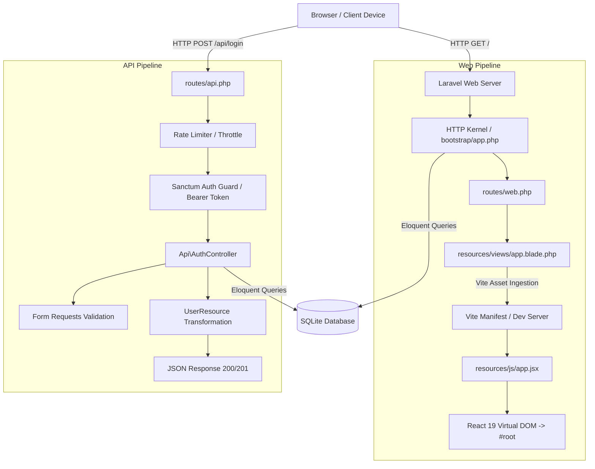

# System Architecture

This document describes the architectural design, component layers, and request lifecycles of the **LD-NI-BOS** application.

---

## 1. High-Level Architecture

The application adopts a **Hybrid Single Page & API Architecture** where:
1. **Laravel 12 / 13 Core** acts as the primary application foundation, handling HTTP routing, session management, CSRF validation, database persistence, and API endpoints.
2. **API & Security Layer (Sanctum)** provides stateless bearer token authentication, request validation through Form Requests, rate limiting, and standard JSON resource serialization.
3. **Blade Hosting Layer** provides lightweight HTML host pages (`app.blade.php`), injecting Vite scripts and React hydration containers.
4. **React 19 Client Layer** renders dynamic user interfaces inside `#root`, styled using **Tailwind CSS v4** engine.



---

## 2. Directory Structure & Responsibilities

```
ld-ni-bos/
├── app/
│   ├── Http/
│   │   ├── Controllers/
│   │   │   ├── Api/
│   │   │   │   └── AuthController.php   # Registration, login, logout, profile
│   │   │   └── Controller.php           # Base controller
│   │   ├── Requests/
│   │   │   └── Auth/
│   │   │       ├── LoginRequest.php     # Login validation rules
│   │   │       └── RegisterRequest.php  # Registration validation rules
│   │   └── Resources/
│   │       └── UserResource.php         # User entity JSON transformation
│   ├── Models/
│   │   └── User.php                     # User model with HasApiTokens & attributes
│   └── Providers/
│       └── AppServiceProvider.php       # Application service providers
├── bootstrap/
│   └── app.php                          # Application configuration & middleware pipeline
├── config/                              # Configuration definitions
├── database/
│   ├── factories/
│   │   └── UserFactory.php              # User factory with admin state
│   ├── migrations/                      # Schema definitions & migrations
│   │   ├── 0001_01_01_000000_create_users_table.php
│   │   ├── 0001_01_01_000001_create_cache_table.php
│   │   ├── 0001_01_01_000002_create_jobs_table.php
│   │   ├── 2026_10_12_053248_create_personal_access_tokens_table.php
│   │   └── 2026_10_12_053400_add_role_and_profile_fields_to_users_table.php
│   └── seeders/
│       └── DatabaseSeeder.php           # Database seeders
├── docs/                                # Technical documentation
├── public/
│   └── index.php                        # Application entrypoint
├── resources/
│   ├── css/
│   │   └── app.css                      # Tailwind CSS v4 root stylesheet
│   ├── js/
│   │   └── app.jsx                      # React 19 application mounting script
│   └── views/
│       ├── app.blade.php                # React SPA host template
│       └── welcome.blade.php            # Static fallback template
├── routes/
│   ├── api.php                          # API routes (Sanctum protected & public)
│   ├── web.php                          # Web routes (session & CSRF enabled)
│   └── console.php                      # Artisan console commands
├── storage/                             # Logs, framework cache, and compiled views
├── tests/
│   ├── Feature/
│   │   └── Auth/
│   │       ├── LoginTest.php            # Login, profile, logout feature tests
│   │       └── RegisterTest.php         # Registration feature tests
│   ├── Unit/
│   └── TestCase.php                     # Base test case class
├── artisan                              # CLI runner for Artisan commands
├── composer.json                        # PHP dependencies and autoload definitions
├── package.json                         # Frontend dependencies and scripts
└── vite.config.js                       # Vite asset bundler configuration
```

---

## 3. Request Lifecycles

### 3.1 Web Request Lifecycle
1. **Entrypoint (`public/index.php`)**: Bootstraps the application via `bootstrap/app.php`.
2. **Web Routing (`routes/web.php`)**: `Route::view('/', 'app')` renders `resources/views/app.blade.php`.
3. **Vite Bridge**: Injects `@viteReactRefresh` and `@vite(['resources/css/app.css', 'resources/js/app.jsx'])`.
4. **React Hydration**: `resources/js/app.jsx` initializes `createRoot(container).render(<App />)`.

### 3.2 API Request Lifecycle (Sanctum)
1. **API Routing (`routes/api.php`)**: Requests targeting `/api/*` are captured by the API pipeline configured in `bootstrap/app.php`.
2. **Rate Limiting**: Public auth endpoints enforce limits (`throttle:10,1` for register, `throttle:6,1` for login) preventing brute-force attacks.
3. **Form Request Validation**: Incoming requests are validated via dedicated Form Request classes (`RegisterRequest`, `LoginRequest`). Invalid data triggers an immediate `422 Unprocessable Entity` JSON response.
4. **Authentication & Token Issuance**: On valid login, `AuthController` issues a hashed personal access token via `$user->createToken()`.
5. **Token Verification**: Protected routes use `auth:sanctum` middleware, verifying the Bearer token in the `Authorization` header against `personal_access_tokens`.
6. **Resource Serialization**: Responses are formatted through Eloquent API Resources (`UserResource`) to ensure clean JSON structures.

---

## 4. Database & Storage Architecture

- **Default Driver**: SQLite (`DB_CONNECTION=sqlite`).
- **Database File**: `database/database.sqlite`.
- **Foreign Keys**: Enabled by default (`DB_FOREIGN_KEYS=true`).
- **Personal Access Tokens**: Stored in `personal_access_tokens` table.
- **Sessions**: Stored in database table `sessions` (`SESSION_DRIVER=database`).
- **Queues**: Stored in database table `jobs` (`QUEUE_CONNECTION=database`).
- **Cache**: Stored in database table `cache` (`CACHE_STORE=database`).
