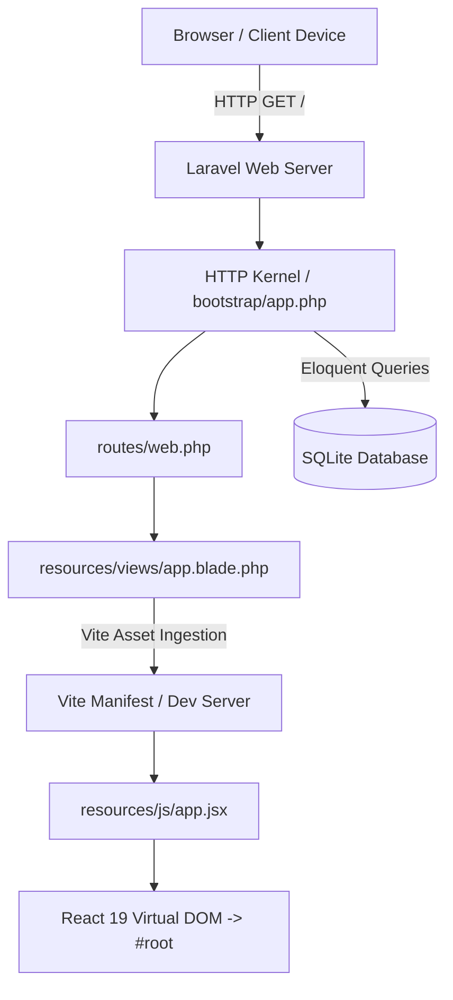

# System Architecture

This document describes the architectural design, component layers, and request lifecycle of the **LD-NI-BOS** application.

---

## 1. High-Level Architecture

The application adopts a **Hybrid Single Page Architecture (SPA)** where:
1. **Laravel 12 / 13 Core** acts as the primary application foundation, handling HTTP routing, session management, CSRF validation, database persistence, and API endpoints.
2. **Blade Hosting Layer** provides lightweight HTML host pages (`app.blade.php`), injecting Vite scripts and React hydration containers.
3. **React 19 Client Layer** renders dynamic user interfaces inside `#root`, styled using **Tailwind CSS v4** engine.



---

## 2. Directory Structure & Responsibilities

```
ld-ni-bos/
├── app/
│   ├── Http/
│   │   └── Controllers/        # Controller classes handling incoming requests
│   ├── Models/                 # Eloquent ORM entity models (e.g. User.php)
│   └── Providers/              # Application service providers (AppServiceProvider.php)
├── bootstrap/
│   └── app.php                 # Application configuration & middleware pipeline
├── config/                     # Configuration definitions (database, app, session, etc.)
├── database/
│   ├── factories/              # Model factories for testing and seeding
│   ├── migrations/             # Schema definitions and versioned migrations
│   └── seeders/                # Database seeders (DatabaseSeeder.php)
├── docs/                       # Project documentation
├── public/
│   └── index.php               # Application entrypoint
├── resources/
│   ├── css/
│   │   └── app.css             # Tailwind CSS v4 root stylesheet
│   ├── js/
│   │   └── app.jsx             # React 19 application mounting script
│   └── views/
│       ├── app.blade.php       # React SPA host template
│       └── welcome.blade.php   # Static fallback template
├── routes/
│   ├── web.php                 # Web routes (session & CSRF enabled)
│   └── console.php             # Artisan console commands
├── storage/                    # Logs, framework cache, and compiled views
├── tests/
│   ├── Feature/                # Integration and HTTP feature tests
│   ├── Unit/                   # Isolated unit tests
│   └── TestCase.php            # Base test case class
├── artisan                     # CLI runner for Artisan commands
├── composer.json               # PHP dependencies and autoload definitions
├── package.json                # Frontend dependencies and scripts
└── vite.config.js              # Vite asset bundler configuration
```

---

## 3. Request Lifecycle

1. **Entrypoint (`public/index.php`)**:
   - Computes `LARAVEL_START`.
   - Checks for maintenance mode (`storage/framework/maintenance.php`).
   - Loads Composer autoloader (`vendor/autoload.php`).
   - Boots application instance via `bootstrap/app.php`.
2. **Application Bootstrap (`bootstrap/app.php`)**:
   - Configures base path.
   - Registers web routing (`routes/web.php`), console routes (`routes/console.php`), and system health check endpoint (`/up`).
   - Configures middleware pipeline and exception rendering rules (e.g., JSON responses for API routes).
3. **Route Dispatching (`routes/web.php`)**:
   - The root route `Route::view('/', 'app')` renders `resources/views/app.blade.php`.
4. **Vite Bridge**:
   - Blade executes `@viteReactRefresh` for Fast Refresh support in development.
   - Blade executes `@vite(['resources/css/app.css', 'resources/js/app.jsx'])` to load bundled CSS and JavaScript.
5. **React Mounting**:
   - `resources/js/app.jsx` targets document element `#root`.
   - React 19 initializes `createRoot(container).render(<App />)`.

---

## 4. Database & Storage Architecture

- **Default Driver**: SQLite (`DB_CONNECTION=sqlite`).
- **Database File**: `database/database.sqlite`.
- **Foreign Keys**: Enabled by default (`DB_FOREIGN_KEYS=true`).
- **Sessions**: Stored in database table `sessions` (`SESSION_DRIVER=database`).
- **Queues**: Stored in database table `jobs` (`QUEUE_CONNECTION=database`).
- **Cache**: Stored in database table `cache` (`CACHE_STORE=database`).
