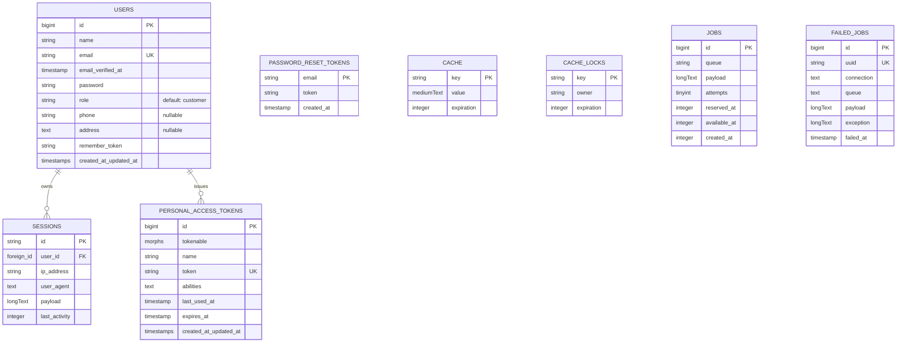

# Backend Architecture & Database

This guide explains the backend architecture, Eloquent models, database schema, routing, and controllers for **LD-NI-BOS**.

---

## 1. Application Core & PHP 8.5 Support

The backend runs on **Laravel Framework 13.x** and **PHP 8.5**.

Key features utilized:
- **Constructor Property Promotion**: Concise service and action constructors.
- **PHP 8.4+ Eloquent Attributes**: Clean declarative model properties (`#[Fillable]`, `#[Hidden]`).
- **Laravel Sanctum Integration**: Built-in API personal access token issuance and verification.
- **Lean Bootstrap Configuration**: Zero-bloat setup in `bootstrap/app.php` with web and API routing.

---

## 2. Eloquent Data Models

### User Model (`app/Models/User.php`)

```php
namespace App\Models;

use Database\Factories\UserFactory;
use Illuminate\Database\Eloquent\Attributes\Fillable;
use Illuminate\Database\Eloquent\Attributes\Hidden;
use Illuminate\Database\Eloquent\Factories\HasFactory;
use Illuminate\Foundation\Auth\User as Authenticatable;
use Illuminate\Notifications\Notifiable;
use Laravel\Sanctum\HasApiTokens;

#[Fillable(['name', 'email', 'password', 'role', 'phone', 'address'])]
#[Hidden(['password', 'remember_token'])]
class User extends Authenticatable
{
    /** @use HasFactory<UserFactory> */
    use HasApiTokens, HasFactory, Notifiable;

    /**
     * Get the attributes that should be cast.
     *
     * @return array<string, string>
     */
    protected function casts(): array
    {
        return [
            'email_verified_at' => 'datetime',
            'password' => 'hashed',
        ];
    }

    /**
     * Determine if the user is an admin.
     */
    public function isAdmin(): bool
    {
        return $this->role === 'admin';
    }

    /**
     * Determine if the user is a customer.
     */
    public function isCustomer(): bool
    {
        return $this->role === 'customer';
    }
}
```

> [!NOTE]
> Modern Laravel applications prefer PHP attributes `#[Fillable]` and `#[Hidden]` over traditional protected array properties for improved static analysis and code cleanliness.

---

## 3. Database Schema & Migrations

The database currently provisions the following core system tables:



### Migration Files (`database/migrations/`)

1. **`0001_01_01_000000_create_users_table.php`**:
   - Creates `users`, `password_reset_tokens`, and `sessions` tables.
2. **`0001_01_01_000001_create_cache_table.php`**:
   - Creates `cache` and `cache_locks` tables for database-backed caching.
3. **`0001_01_01_000002_create_jobs_table.php`**:
   - Creates `jobs`, `job_batches`, and `failed_jobs` tables for asynchronous queue processing.
4. **`2026_10_12_053248_create_personal_access_tokens_table.php`**:
   - Creates `personal_access_tokens` table for Laravel Sanctum API authentication.
5. **`2026_10_12_053400_add_role_and_profile_fields_to_users_table.php`**:
   - Adds `role` (default `'customer'`), `phone`, and `address` columns to `users`.

---

## 4. Routing Structure

### Web Routes (`routes/web.php`)

Web routes handle stateful HTTP requests with session and CSRF middleware:

```php
use Illuminate\Support\Facades\Route;

Route::view('/', 'app');
```

### API Routes (`routes/api.php`)

API routes handle stateless JSON interactions with Sanctum bearer token authentication:

```php
use App\Http\Controllers\Api\AuthController;
use Illuminate\Support\Facades\Route;

// Public Authentication Endpoints (Rate Limited)
Route::prefix('auth')->group(function (): void {
    Route::post('/register', [AuthController::class, 'register'])->middleware('throttle:10,1');
    Route::post('/login', [AuthController::class, 'login'])->middleware('throttle:6,1');
});

Route::post('/register', [AuthController::class, 'register'])->middleware('throttle:10,1');
Route::post('/login', [AuthController::class, 'login'])->middleware('throttle:6,1');

// Protected Routes (auth:sanctum)
Route::middleware('auth:sanctum')->group(function (): void {
    Route::get('/user', [AuthController::class, 'user']);
    Route::post('/logout', [AuthController::class, 'logout']);
    Route::post('/auth/logout', [AuthController::class, 'logout']);
});
```

### Console Routes (`routes/console.php`)

Artisan console commands:

```php
use Illuminate\Foundation\Inspiring;
use Illuminate\Support\Facades\Artisan;

Artisan::command('inspire', function () {
    $this->comment(Inspiring::quote());
})->purpose('Display an inspiring quote');
```

---

## 5. API Form Requests, Resources & Controllers

### Form Requests (`app/Http/Requests/Auth/`)
- **`RegisterRequest.php`**: Validates registration input (`name`, unique `email`, `password` confirmation with min 8 characters, optional `phone` and `address`).
- **`LoginRequest.php`**: Validates authentication input (`email`, `password`, optional `device_name`).

### API Resources (`app/Http/Resources/`)
- **`UserResource.php`**: Transforms the User Eloquent model into a clean, consistent JSON shape without exposing sensitive database internals.

### Authentication Controller (`app/Http/Controllers/Api/AuthController.php`)
- **`register`**: Creates customer record, generates Sanctum personal access token, and returns HTTP 201 with bearer token.
- **`login`**: Authenticates credentials against Bcrypt hash, creates a named token, and returns HTTP 200 with bearer token.
- **`logout`**: Deletes the user's current access token, invalidating future requests with that token.
- **`user`**: Returns the authenticated user wrapped in `UserResource`.

---

## 6. Creating New Backend Components

Always adhere to Laravel Artisan generators:

### Generate Model with Migration, Factory & Seeder
```bash
php artisan make:model Post -mfs --no-interaction
```

### Generate API Controller
```bash
php artisan make:controller Api/PostController --api --model=Post --no-interaction
```

### Generate Form Request
```bash
php artisan make:request StorePostRequest --no-interaction
```

### Generate Eloquent API Resource
```bash
php artisan make:resource PostResource --no-interaction
```
