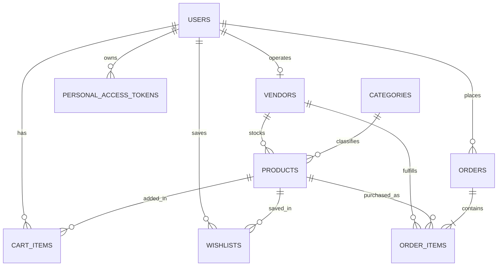
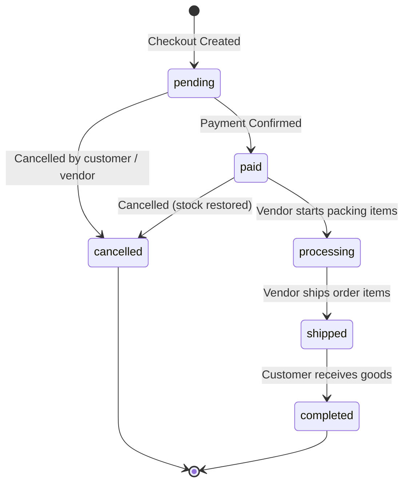

# Backend Architecture & Database

This guide explains the backend architecture, Eloquent models, database schema, routing, and controllers for **LD-NI-BOS**.

---

## 1. Application Core & PHP 8.5 Support

The backend runs on **Laravel Framework 13.x** and **PHP 8.5**.

Key features utilized:
- **Constructor Property Promotion**: Concise service and action constructors.
- **PHP 8.4+ Eloquent Attributes**: Clean declarative model properties (`#[Fillable]`, `#[Hidden]`).
- **Laravel Sanctum Integration**: Stateless API personal access token issuance and verification.
- **Multi-Vendor Isolation**: Multi-vendor store profiles, isolated vendor product inventories, and vendor order fulfillment.
- **Unified Checkout Pipeline**: Flexible checkout handling direct item payloads (frontend SPA) and atomic cart checkouts.
- **Multi-Database Compatibility**: Default SQLite (`database/database.sqlite`) for development with automated `DATABASE_URL` fallback for PostgreSQL (`pgsql`) and MySQL (`mysql`) in containerized/Render production environments.
- **Cloud Reverse Proxy & SSL**: Configured with `$middleware->trustProxies(at: '*')` in `bootstrap/app.php` and `URL::forceScheme('https')` in `AppServiceProvider.php` for seamless SSL offloading.

---

## 2. Eloquent Data Models

### User Model (`app/Models/User.php`)
Represents customer, vendor, and administrator accounts.
- Attributes: `name`, `email`, `password`, `role` (`'customer'`, `'vendor'`, `'admin'`), `phone`, `address`.
- Relations:
  - `vendor()`: `HasOne` to `Vendor`
  - `orders()`: `HasMany` to `Order`
  - `cartItems()`: `HasMany` to `CartItem`
  - `wishlists()`: `HasMany` to `Wishlist`
  - `wishlistProducts()`: `BelongsToMany` to `Product` through `wishlists`
- Helpers: `isAdmin()`, `isCustomer()`, `isVendor()`.

### Vendor Model (`app/Models/Vendor.php`)
Represents vendor stores operating on the platform.
- Attributes: `user_id`, `store_name`, `store_slug`, `description`, `logo_url`, `banner_url`, `phone`, `address`, `city`, `province`, `postal_code`, `is_verified`.
- Relations:
  - `user()`: `BelongsTo` `User`
  - `products()`: `HasMany` `Product`
  - `orderItems()`: `HasMany` `OrderItem`

### Category Model (`app/Models/Category.php`)
Hierarchical PC part and component categories.
- Attributes: `name`, `slug`, `description`, `icon`, `is_active`.
- Relations:
  - `products()`: `HasMany` `Product`

### Product Model (`app/Models/Product.php`)
Catalog items (PC components and pre-built systems).
- Attributes: `category_id`, `vendor_id`, `sku`, `name`, `slug`, `type` (`'part'`, `'prebuilt'`), `brand`, `price`, `stock`, `description`, `specifications`, `image_url`, `images`, `is_active`, `weight_grams`.
- Scopes: `active()`, `inStock()`, `prebuilt()`, `part()`, `search()`, `category()`, `byVendor()`.
- Relations:
  - `category()`: `BelongsTo` `Category`
  - `vendor()`: `BelongsTo` `Vendor`
  - `cartItems()`: `HasMany` `CartItem`
  - `wishlists()`: `HasMany` `Wishlist`

### CartItem Model (`app/Models/CartItem.php`)
Active customer shopping cart items.
- Attributes: `user_id`, `product_id`, `quantity`.
- Relations:
  - `user()`: `BelongsTo` `User`
  - `product()`: `BelongsTo` `Product`
- Controller Integration (`CartController.php`):
  - `index()`: Returns items with computed line item subtotals, item count, total quantity, and formatted Rupiah totals.
  - `store()` & `storeBulk()`: Supports single item or array of items with transactional verification. Includes `resolveProduct()` which resolves hardware by numeric ID, slug, or PC builder mock code alias (`cpu-1` -> Intel Core i9-14900K, `vga-1` -> RTX 4070 SUPER, etc.).
  - `update()`: Modifies line item quantity with real-time inventory limits.
  - `destroy()` & `clear()`: Removes individual items or flushes the user's cart.

### Wishlist Model (`app/Models/Wishlist.php`)
Saved customer product bookmarks.
- Attributes: `user_id`, `product_id`.
- Relations:
  - `user()`: `BelongsTo` `User`
  - `product()`: `BelongsTo` `Product`

### Order Model (`app/Models/Order.php`)
Parent order placed by a customer.
- Attributes: `order_number`, `user_id`, `status` (`'pending'`, `'paid'`, `'processing'`, `'shipped'`, `'completed'`, `'cancelled'`), `payment_method`, `shipping_method`, `recipient_name`, `recipient_phone`, `shipping_phone`, `shipping_address`, `customer_note`, `notes`, `subtotal`, `shipping_cost`, `total`, `total_amount`.
- Automatic synchronization: A model lifecycle `creating` hook ensures `total` and `total_amount`, as well as `shipping_phone` and `recipient_phone`, remain synchronized.
- Relations:
  - `user()`: `BelongsTo` `User`
  - `items()`: `HasMany` `OrderItem`
- Helpers: `generateOrderNumber()`, `isCancellable()`.

### OrderItem Model (`app/Models/OrderItem.php`)
Itemized product line inside an order, attributed to a specific vendor.
- Attributes: `order_id`, `product_id`, `vendor_id`, `product_name`, `product_sku`, `unit_price`, `quantity`, `subtotal`, `status`.
- Automatic inference: A model lifecycle `creating` hook automatically infers `vendor_id` and `product_sku` from the associated `Product`, guaranteeing multi-vendor attribution even for cart-based checkout.
- Relations:
  - `order()`: `BelongsTo` `Order`
  - `product()`: `BelongsTo` `Product`
  - `vendor()`: `BelongsTo` `Vendor`

---

## 3. Database Schema & Relationships

### Key Migration History

1. **`0001_01_01_000000_create_users_table.php`**: Base authentication tables (`users`, `password_reset_tokens`, `sessions`).
2. **`2026_10_12_053248_create_personal_access_tokens_table.php`**: Sanctum personal access tokens.
3. **`2026_10_12_053400_add_role_and_profile_fields_to_users_table.php`**: Adds `role`, `phone`, and `address` to `users`.
4. **`2026_10_12_102904_create_categories_table.php`**: PC parts and systems categories.
5. **`2026_10_12_102916_create_products_table.php`**: Catalog products with specifications and stock.
6. **`2026_10_12_102927_create_cart_items_table.php`**: Customer shopping carts.
7. **`2026_10_12_102938_create_wishlists_table.php`**: Customer wishlists.
8. **`2026_10_12_133422_create_orders_table.php`**: Primary orders table.
9. **`2026_10_12_133423_create_order_items_table.php`**: Primary order items table.
10. **`2026_10_12_152255_create_vendors_table.php`**: Multi-vendor store registry.
11. **`2026_10_12_152305_add_vendor_id_to_products_table.php`**: Links catalog products to vendors.
12. **`2026_10_12_163128_create_orders_table.php`**: Idempotent migration that safely adds vendor checkout columns (`shipping_method`, `recipient_name`, `recipient_phone`, `customer_note`, `subtotal`, `shipping_cost`, `total`, indexes) when table already exists.
13. **`2026_10_12_163132_create_order_items_table.php`**: Idempotent migration that safely links `vendor_id` and `product_sku` to `order_items` once `vendors` table is present.
14. **`2026_10_12_163240_add_sku_to_products_table.php`**: Adds `sku` and unique `['vendor_id', 'sku']` constraint to products.
15. **`2026_10_12_164125_add_unique_user_constraint_to_vendors_table.php`**: Enforces one vendor store per user account.
16. **`2026_10_12_164305_add_status_to_order_items_table.php`**: Adds granular item fulfillment status (`pending`, `processing`, `shipped`, `completed`, `cancelled`).

### Database Seeders (`database/seeders/`)

The application provides out-of-the-box realistic seeders:
- **`DatabaseSeeder.php`**: Primary entry point. Seeds baseline demo users:
  - Administrator: `admin@example.com` / `password123` (`role: admin`)
  - Customer: `customer@example.com` / `password123` (`role: customer`)
  - Calls `CategorySeeder` and `ProductSeeder`.
- **`CategorySeeder.php`**: Populates hardware categories (`pc-siap-pakai`, `processor`, `motherboard`, `kartu-grafis`, `ram`, `storage`, `power-supply`, `casing`, `aksesoris`).
- **`ProductSeeder.php`**: Populates pre-built gaming rigs and individual PC parts with authentic specs (sockets, wattage, memory standards, warranty), high-resolution imagery, and stock levels.

---

## 4. Multi-Vendor Order Lifecycle

### Multi-Vendor Item-Level Status Resolution
- In multi-vendor transactions, an order contains items from different vendors.
- Each vendor manages their own items via `PATCH /api/vendor/orders/{order}/status`.
- If an item is cancelled, stock for that vendor's product is restored atomically.
- When all items in an order reach a unanimous status (e.g., all shipped), the parent order's status transitions automatically.

---

## 5. Unified Checkout Architecture

The platform supports two checkout modalities through `/api/checkout`:

1. **Direct Itemized Checkout (`POST /api/checkout`)**:
   - Used by the React frontend (`CheckoutPage.jsx`) and API clients.
   - Accepts payload containing `items: [{ product_id, quantity }]`, shipping options, and recipient details.
   - Validates stock across all items with pessimistic database row locks (`lockForUpdate`).
   - Decrements product inventory and snapshots vendor attribution.
   - Returns HTTP 201 with created order details.

2. **Cart-Based Checkout (`POST /api/checkout` or `POST /api/orders/checkout`)**:
   - Used for quick conversion of a user's persistent cart (`cart_items`).
   - Invoked when no `items` array is provided in payload.
   - Verifies stock and availability for every item in the cart.
   - Snapshots each cart item into `order_items`, auto-populates `vendor_id` and `sku`, decrements stock, and empties the cart.

---

## 6. API Route Catalog

### Authentication
- `POST /api/register`: Register new customer account (rate limited: 10/min)
- `POST /api/login`: Authenticate and receive Sanctum bearer token (rate limited: 6/min)
- `GET /api/user`: Get authenticated user profile (`auth:sanctum`)
- `POST /api/logout`: Revoke active bearer token (`auth:sanctum`)

### Catalog & Discovery
- `GET /api/categories`: List all component categories
- `GET /api/categories/{slug}`: Category detail with product count
- `GET /api/products`: Filterable product catalog (search, type, category, pagination)
- `GET /api/products/{slug}`: Product details with specifications and active status
- `GET /api/products/{slug}/related`: Related category products

### Wishlist & Shopping Cart
- `GET /api/wishlist`: List user wishlist
- `POST /api/wishlist`: Add product to wishlist
- `POST /api/wishlist/toggle`: Toggle product in wishlist
- `DELETE /api/wishlist/{productId}`: Remove product from wishlist
- `GET /api/cart`: Current cart summary with calculated totals
- `POST /api/cart`: Add or increment item in cart
- `POST /api/cart/bulk`: Bulk synchronize cart items
- `PATCH /api/cart/{cartItemId}`: Update item quantity
- `DELETE /api/cart/{cartItemId}`: Remove cart item
- `DELETE /api/cart`: Clear entire cart

### Customer Orders & Checkout
- `POST /api/checkout`: Unified checkout (supports direct items and cart fallback)
- `POST /api/orders/checkout`: Dedicated cart-to-order checkout
- `GET /api/orders`: List customer order history
- `GET /api/orders/{id}`: Single order breakdown with item statuses
- `PATCH /api/orders/{id}/cancel`: Cancel cancellable order (`pending` or `paid`) and restore stock

### Vendor Portal
- `GET /api/vendor/store`: Vendor profile and catalog metrics
- `POST /api/vendor/store`: Register new vendor store
- `PATCH /api/vendor/store`: Update store details
- `GET /api/vendor/products`: Vendor-owned product inventory
- `POST /api/vendor/products`: Create vendor product
- `PATCH /api/vendor/products/{product}`: Update vendor product
- `DELETE /api/vendor/products/{product}`: Delete vendor product
- `GET /api/vendor/dashboard`: Store performance metrics (gross sales, sold units, new orders)
- `GET /api/vendor/orders`: Vendor orders with item-level status filtering
- `PATCH /api/vendor/orders/{order}/status`: Update fulfillment status of vendor items
