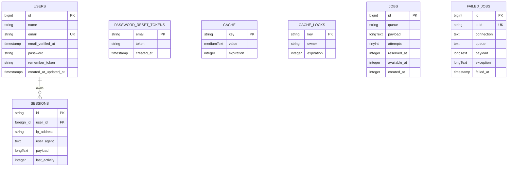

# Backend Architecture & Database

This guide explains the backend architecture, Eloquent models, database schema, routing, and controllers for **LD-NI-BOS**.

---

## 1. Application Core & PHP 8.5 Support

The backend runs on **Laravel Framework 13.x** and **PHP 8.5**.

Key features utilized:
- **Constructor Property Promotion**: Concise service and action constructors.
- **PHP 8.4+ Eloquent Attributes**: Clean declarative model properties (`#[Fillable]`, `#[Hidden]`).
- **Lean Bootstrap Configuration**: Zero-bloat setup in `bootstrap/app.php`.

---

## 2. Eloquent Data Models

### User Model (`app/Models/User.php`)

```php
namespace App\Models;

use Database\Factories\UserFactory;
use Illuminate\Database\Eloquent\Attributes\Fillable;
use Illuminate\Database\Eloquent\Attributes\Hidden;
use Illuminate\Database\Eloquent\Factories\HasFactory;
use Illuminate\Foundation\Auth\User as Authenticatable;
use Illuminate\Notifications\Notifiable;

#[Fillable(['name', 'email', 'password'])]
#[Hidden(['password', 'remember_token'])]
class User extends Authenticatable
{
    /** @use HasFactory<UserFactory> */
    use HasFactory, Notifiable;

    /**
     * Get the attributes that should be cast.
     *
     * @return array<string, string>
     */
    protected function casts(): array
    {
        return [
            'email_verified_at' => 'datetime',
            'password' => 'hashed',
        ];
    }
}
```

> [!NOTE]
> Modern Laravel applications prefer PHP attributes `#[Fillable]` and `#[Hidden]` over traditional protected array properties for improved static analysis and code cleanliness.

---

## 3. Database Schema & Migrations

The database currently provisions the following core system tables:



### Migration Files (`database/migrations/`)

1. **`0001_01_01_000000_create_users_table.php`**:
   - Creates `users`, `password_reset_tokens`, and `sessions` tables.
2. **`0001_01_01_000001_create_cache_table.php`**:
   - Creates `cache` and `cache_locks` tables for database-backed caching.
3. **`0001_01_01_000002_create_jobs_table.php`**:
   - Creates `jobs`, `job_batches`, and `failed_jobs` tables for asynchronous queue processing.

---

## 4. Routing Structure

### Web Routes (`routes/web.php`)

Web routes handle stateful HTTP requests with session and CSRF middleware:

```php
use Illuminate\Support\Facades\Route;

Route::view('/', 'app');
```

### Console Routes (`routes/console.php`)

Closure-based Artisan console commands:

```php
use Illuminate\Foundation\Inspiring;
use Illuminate\Support\Facades\Artisan;

Artisan::command('inspire', function () {
    $this->comment(Inspiring::quote());
})->purpose('Display an inspiring quote');
```

---

## 5. Creating New Backend Components

Always adhere to Laravel Artisan generators:

### Generate Model with Migration, Factory & Seeder
```bash
php artisan make:model Post -mfs --no-interaction
```

### Generate API Controller
```bash
php artisan make:controller Api/PostController --api --model=Post --no-interaction
```

### Generate Form Request
```bash
php artisan make:request StorePostRequest --no-interaction
```

### Generate Eloquent API Resource
```bash
php artisan make:resource PostResource --no-interaction
```
